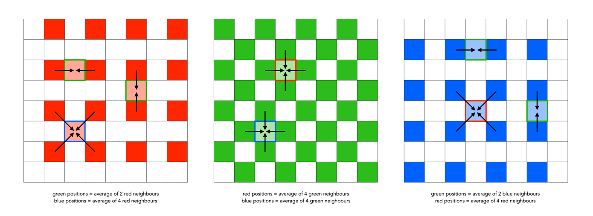

# Denoising and Demosaicing Methods
> [!IMPORTANT]
> This list represents an in-no-way-comprehensive collection of denoising and demosaicing methods. They are an assortment of industry-standard methodologies, specific implementations and approaches, and general categories. Standard approaches like Bilinear and AHD will have specific implementations noted, while methods derived from papers use the authors' implementations and naming schemes.

This list is split into demosaicing-only methods, which only de-Bayer raw images, denoising-only methods, which only remove noise from the raw (or de-Bayered image), joint methods which accomplish both at the same time, and multi-stage methods, which operate as a bundle but perform denoising and demosaicing as separate steps.

***

### Demosaicing Only Methods:

#### Bilinear
##### Overview
|  |
|:--:|
| *Bilinear interpolation process* [*(Crafting Pixels)*](https://pixelcraft.photo.blog/tag/bilinear-demosaicing/) |

##### Notes

 

#### Improved Linear Demosaicing
##### Overview
|  |
|:--:| 
| *Filter coefficients for improved linear demosaicing* [*(Microsoft Research)*](https://www.microsoft.com/en-us/research/wp-content/uploads/2016/02/Demosaicing_ICASSP04.pdf) |

##### Notes
- [Paper](https://www.microsoft.com/en-us/research/wp-content/uploads/2016/02/Demosaicing_ICASSP04.pdf)

 

#### Adaptive Homogeneity-Directed Demosaicing (AHD)
##### Overview
##### Notes
- [Whitepaper](https://ieeexplore.ieee.org/document/1395991)

 

#### Variable Number of Gradient (VNG)
##### Overview
##### Notes

 

#### Patterned Pixel Grouping (PPG)
##### Overview
##### Notes

 

#### High Quality Linear Interpolation (HQLI)
##### Overview
##### Notes

 

#### Directional Filtering and a Posteriori Decision (DFPD)
##### Overview
##### Notes

 

#### Multiple Gradients (MG)
##### Overview
##### Notes

***

### Denoising Only Methods:

#### Non-Local Means & Patch-Based Difference (NLM/PBD)
##### Overview
##### Notes
- [Paper](https://www.researchgate.net/publication/317244370_Denoising_Algorithm_for_CFA_Image_Sensors_Considering_Inter-Channel_Correlation)

 

#### DTDeMo
##### Overview
##### Notes
- [Paper](https://www.researchgate.net/publication/382151929_DTDeMo_A_Deep_Learning-based_Two-stage_Image_Demosaicing_Model_with_Interpolation_and_Enhancement)

***

### Joint Methods:

#### Generative Adversarial Network (GAN)
##### Overview
##### Notes
- [Paper](https://www.sciencedirect.com/science/article/abs/pii/S0925231221001181)

 

#### Joint Demosaicing and Denoising Light (JDD-LI)
##### Overview
##### Notes
- [Paper](https://www.sciencedirect.com/science/article/pii/S1047320326002191?utm_source=chatgpt.com)

 

#### Mutual Guidance of COlor Channels (MGCC)
##### Overview
##### Notes
- [Paper](https://www.sciencedirect.com/science/article/abs/pii/S0165168422002134)

 

#### Unified Multi-bayer Demosaicing (UMBD)
##### Overview
##### Notes
- [Paper](https://arxiv.org/html/2504.07145v2)

***

### Multi-Stage Methods:

#### Demosaic-First CNN (DF-CNN)
##### Overview
##### Notes
- [Implementation/Paper](https://www.sciencedirect.com/science/article/abs/pii/S0377042723002741)