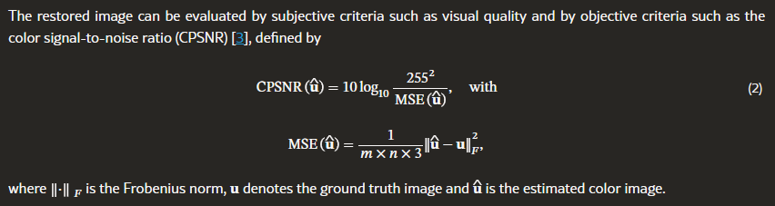
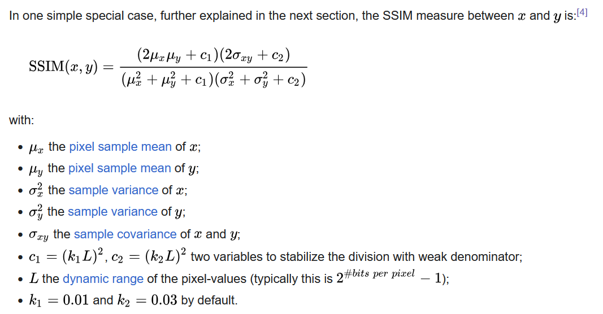

# Evaluation Metrics
> [!WARNING]
> This is all mostly noodling around right now.

 

#### Color Peak Signal-to-Noise Ratio (CPSNR)
Measures error in computed (processed) image and normalizes it to the size of the image. Is unitless, but provides a metric for how well the image was reconstructed by the processing pipeline. Is NOT a measure of noise in the image itself, raw or processed. 

|  |
|:--:|
| *CPSNR Formula* [*(Guo et al.)*](https://arxiv.org/abs/2408.06684v1) |

A small MSE means similar images, while a large MSE means they are more dissimilar, while an MSE of 0 indicates identical images. This is then converted to a logarithmic figure, expressed in *decibels*. Higher CPSNR indicates better reconstruction. An infinitely-large CPSNR corresponds to an MSE of 0, or perfect reconstruction.

The 255 in the above formula corresponds to the maximum value/bit depth of the images. Our implementation replaces this with a "peak" value that is either automatically determined based on the file type or manually passed (like if a 12-bit image has been cast to a 16-bit variable) (peak for 8-bit = 255, for 16-bit = 65535, etc.).

 

#### Structural Similarity Index Measure (SSIM)
Perceived quality assessment used to compare similarity of reference and processed images. Acts upon the initial, full-color, raw image as reference. Considers image degredation using perceived change in structural information, while also accounting for perceptual phenomena driven by luminance and contrast.

|  |
|:--:|
| *Basic single-channel SSIM formula* [*(Wang, Z.; Simoncelli, E.P.; Bovik, A.C.)*](https://ieeexplore.ieee.org/abstract/document/1292216) |

Attempts to assess effects had on correlated pixels, enar one another, using a sliding Gaussian window of effect/consequence. The method applied here is basic SSIM, which is more than competent enough for assessing image differences as we are assessing here (not a complex video dataset). Retains deterministic, quantitative properties, while some other SSIM methods are qualitative, fitting to subjective observation data.

 

#### Natural Environment Quality Evaluator (NIQE)
Per the NFDi4ing consortium:
>"The Natural Image Quality Evaluator (NIQE) metric makes only use of measurable deviations from statistical regularities observed in natural images, without training on human-rated distorted images, and, indeed without any exposure to distorted images. It is based on the construction of a quality aware collection of statistical features based on a simple and successful space domain natural scene statistic (NSS) model. These features are derived from a corpus of natural, undistorted images."

Python implementation here: https://github.com/guptapraful/niqe

> [!NOTE]
> Reference material to possibly add to above section:
>Papers mention the “NIQE performance metric and the correlation coefficient”
>- https://thesai.org/Downloads/Volume14No10/Paper_3-Comparison_of_Four_Demosaicing_Methods.pdf
>
>The NIQE:
>- https://quality.nfdi4ing.de/en/latest/image_quality/NIQE.html.
>- Scores with 0 being best.

 

#### What do WE as a group care about?
Not sure. Possibly:
- Computation cost
- Denoising capacity
  - What types of noise?
    - Photon shot noise
    - Sensor read noise
- Accuracy -> how do we quantify this?
- Do these metrics (any/all) depend on sensor resolution or pixel size/density?
- Deviation from “lazy” use of quarter-resolution mosaic result -> does this make actually-sampled color information worse?
- What is scale of noise and error introduced relative to data? SNR? Artificial Error-to-noise ratio?
- Depending on how fast the images are taken relative to the sample noise, drizzling may help improve resolution without “guessing” with demosaicing.
- Are we measuring spatial or temporal noise of the sample? Denoising and combined steps (JDD) are going to flatten spatial noise, whether sample or sensor, without discerning between them.
- Are learning methods deterministic? Does it matter?