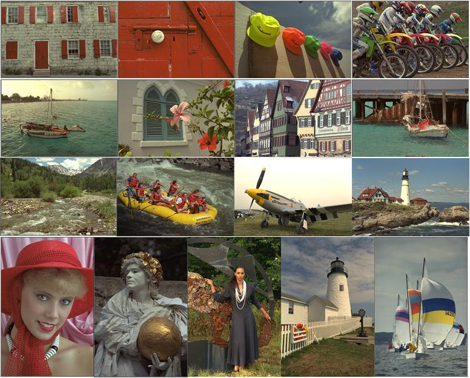
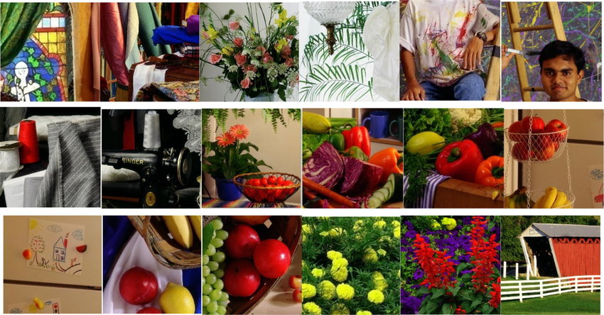

# Test Datasets
In order to evaluate the effectiveness of different denoising and demosaicing methods, we need to be able to establish a ground truth, which they are attempting to restore some distorted image to. This requires "true-color", "full resolution" image datasets, onto which fake noise and Bayer filtering is applied, from which the methods we test attempt to recover the original image.

There are a handful of common image sets that come up with some frequency. We use several in our testing, and expose tooling to use others as needed.

***

### Image Sets

#### Kodak Lossless True Color Image Suite

By far the most common set of images used for compression, denoising, and image modification algorithm assessment.
- https://r0k.us/graphics/kodak/
- https://github.com/MohamedBakrAli/Kodak-Lossless-True-Color-Image-Suite

#### IMAX

This gets mentioned a lot but I can't find it? It maybe comes from here: https://www.spiedigitallibrary.org/conference-proceedings-of-spie/6822/1/Image-demosaicing-a-systematic-survey/10.1117/12.766768.full

 

### Methods for Applying Noise and Mosaicing

#### False Noise

#### False Mosaicing